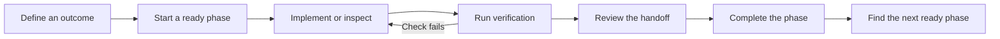

<div align="center">

# PhaseGate

### Give your AI coding workflow a clear next step.

Plan small outcomes. Run real checks. Leave reviewed handoffs.

[](https://github.com/Sujitsarkar16/phasegate/actions/workflows/test.yml)
[](LICENSE)
[](package.json)
[](package.json)

[Start here](BEGINNER_GUIDE.md) · [CLI reference](CLI_GUIDE.md) · [Contribute](CONTRIBUTING.md) · [Report an issue](https://github.com/Sujitsarkar16/phasegate/issues)

</div>

AI can write code quickly. Keeping track of what is ready, what was tested, and what the next session needs takes work. **PhaseGate** is a lightweight CLI for organizing AI-assisted software development into small, verifiable phases.

It computes dependency readiness, runs your declared checks, records evidence against code snapshots, and requires a reviewed handoff before a phase can finish. Use it with your coding agent or directly from the terminal.

## New to agentic workflows?

**Beginners can find the workflow difficult to understand at first:** phases, gates, verification evidence, and handoffs introduce unfamiliar terms. You do not need to learn them all at once. Start with one small phase and follow the [beginner walkthrough](BEGINNER_GUIDE.md), which includes a runnable greeting example and explains every command.

A **phase** is a small outcome. A **check** demonstrates a part of that outcome. A **handoff** records what changed, how it was checked, and what comes next.



## Why use PhaseGate?

| When development gets messy | PhaseGate helps you |
| :--- | :--- |
| A new session has lost the thread | Resume from phase context, checkpoints, and prerequisite handoffs |
| Work starts before its dependencies are ready | Start only when prerequisites and prerequisite gates are satisfied |
| A task is called done without recorded checks | Require current passing verification and a reviewed handoff |
| Important source contracts change later | Detect stale completion for declared watched paths |
| A large task becomes hard to review | Split it into smaller phases with explicit acceptance criteria |

Requires **Node.js 18+**. **Zero runtime dependencies.** MIT licensed. The package name is `agentic-phase-gate`; the CLI name is `phasegate`.

## Try it from this repository

```sh
git clone https://github.com/Sujitsarkar16/phasegate.git
cd phasegate
npm test
npm run demo:init
node bin/phasegate.js next examples/beginner-demo/Implementation_Plan
```

No dependency installation is needed for this checkout. The demo creates an unverified plan with real greeting tests already configured. Continue with [the walkthrough](BEGINNER_GUIDE.md) to start, verify, review, and complete it.

## Use it in your own project

From the PhaseGate checkout, scaffold a plan:

```sh
node bin/phasegate.js init ./Implementation_Plan --name "My feature" --mode light
node bin/phasegate.js validate ./Implementation_Plan
node bin/phasegate.js next ./Implementation_Plan
```

For another repository, use the absolute path to `bin/phasegate.js` from that project's working directory. The plan belongs inside the project workspace. `light` creates one phase; `standard` creates a baseline and first feature slice plus release guidance.

**Before verification, configure `phase-manifest.json` with your source paths, observable acceptance criteria, and actual test commands.** The scaffold check intentionally fails until you replace it. See the [manifest example](CLI_GUIDE.md#a-phase-definition).

```sh
node bin/phasegate.js start P00 ./Implementation_Plan --owner engineer-session-1
node bin/phasegate.js verify P00 ./Implementation_Plan --owner engineer-session-1
node bin/phasegate.js handoff P00 ./Implementation_Plan
```

Fill and review `Implementation_Plan/state/drafts/P00.md`, remove its draft marker, and record the actual reviewer:

```sh
node bin/phasegate.js complete P00 ./Implementation_Plan --owner engineer-session-1 --reviewer engineer --handoff ./Implementation_Plan/state/drafts/P00.md
node bin/phasegate.js status ./Implementation_Plan
```

An npm package installation uses the name `agentic-phase-gate`. These commands require that version to be available on your npm registry; the source checkout above works without an npm release:

```sh
npm install --save-dev agentic-phase-gate
npx agentic-phase-gate init ./Implementation_Plan --mode light
```

## Working with coding agents

Provide the output of `phasegate next` to your coding agent, or install this folder as an agent skill with its linked guides and CLI. [SKILL.md](SKILL.md) defines the execution protocol. The CLI works independently of a specific model or editor; configure checks that match your project.

Discovery roots guide investigation, and agents can follow relevant dependencies. Context budgets are planning estimates. For concurrent workers, use separate worktrees and plans, then verify the integrated revision. One plan allows one active phase; separate plans in the same worktree are not coordinated by its lock.

## What the evidence means

PhaseGate enforces workflow transitions; it does not guarantee software correctness or eliminate agent errors. A passing command proves only what its checks actually exercise.

`watch` paths identify source contracts whose changes should invalidate completion. Whole-workspace fingerprints protect the interval between verification and completion. Changes outside watched contracts need an explicit impact review; ignored files, dependencies, external services, and runtime environments need suitable project checks.

Artifacts use unique names and digest checks. They are not signed or tamper-proof. Owner and reviewer labels record accountability without authenticating people. Use trusted CI, authenticated reviews, and controlled release credentials for stronger assurance. Per-plan locks and recoverable transactions help preserve state across interrupted sessions.

Version 2 uses a new evidence schema. Existing version 1 plans need [explicit migration](CLI_GUIDE.md#migrating-version-1-plans).

## Explore the project

| Guide | What you will learn |
| :--- | :--- |
| [Beginner walkthrough](BEGINNER_GUIDE.md) | Your first verified phase, explained step by step |
| [CLI and schema](CLI_GUIDE.md) | Commands, manifests, gates, ownership, and migration |
| [Feature lifecycle](HOW_IT_WORKS.md) | Plan, execute, resume, split, integrate, and release |
| [Architecture](ARCHITECTURE.md) | Implementation and boundaries of the guarantees |
| [Engineering guide](AI_ASSISTED_SYSTEMS_ENGINEERING.md) | Acceptance criteria and practical engineering decisions |
| [Evaluation](EVALUATION.md) | Measure completion quality, rework, cost, and recovery |

## Build it with us

Documentation improvements, small examples, bug reports, and focused code contributions are welcome. If a workflow step is confusing, [tell us where you got stuck](https://github.com/Sujitsarkar16/phasegate/issues/new/choose). Read [CONTRIBUTING.md](CONTRIBUTING.md) to get started.

```sh
npm test
npm run test:coverage
npm pack --dry-run
```

CI runs behavioral checks on Linux and Windows with Node 18, 22, and 24. Tests exercise evidence failures, staleness, gates, ownership, splits, path safety, recovery, and CLI behavior.

Created by **Satyabodhi AI**. Maintained on GitHub by [Sujit Sarkar](https://github.com/Sujitsarkar16). Released under the [MIT license](LICENSE).
